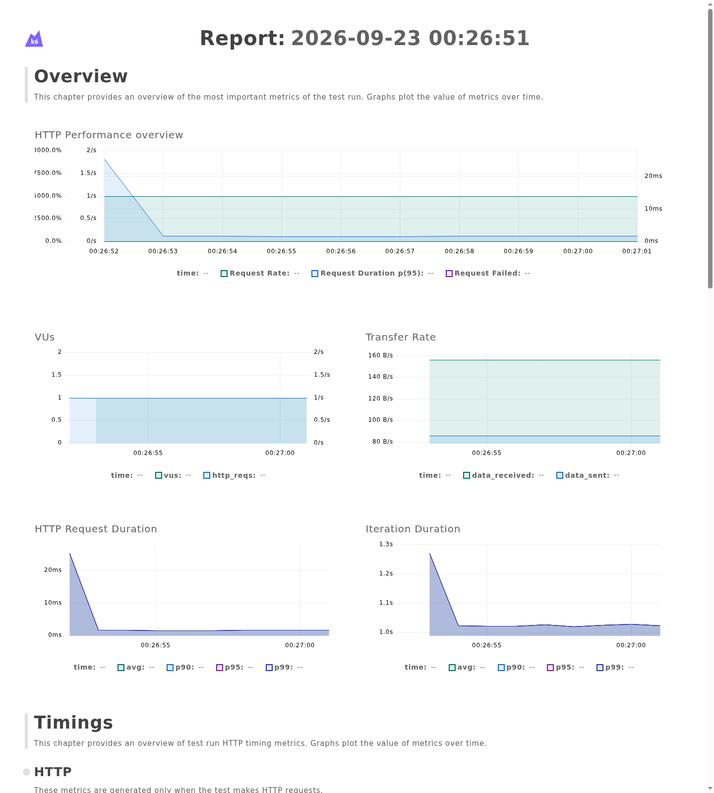
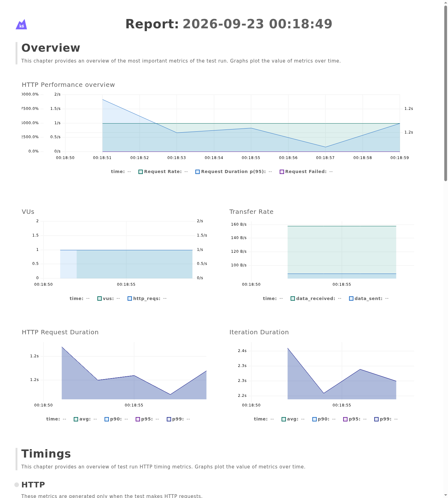

# Performance Regression Gate

[English](README.md) | **Español**

Proyecto de QA orientado a detectar automáticamente regresiones de rendimiento mediante **k6**, **FastAPI**, **Docker** y **GitHub Actions**.

La aplicación puede ejecutarse en modo normal o degradado. k6 mide su comportamiento y aplica un quality gate que decide si el rendimiento es aceptable.

## Demo

Demo visual pública:

https://joseantoniocgonzalez.github.io/performance-regression-gate/

La demo permite comparar los dos escenarios y consultar las ejecuciones reales de GitHub Actions.

## Objetivo

El proyecto demuestra que una aplicación puede seguir funcionando correctamente a nivel funcional y, aun así, sufrir una regresión de rendimiento suficientemente grave como para bloquear una entrega.

El quality gate comprueba:

- p95 de latencia inferior a 500 ms.
- tasa de peticiones HTTP fallidas inferior al 1 %.
- más del 99 % de checks correctos.

Si alguno de estos límites se incumple, k6 devuelve un error y GitHub Actions marca la ejecución como fallida.

## Escenarios

### Normal

La API responde sin introducir retrasos artificiales.

Resultado verificado en GitHub Actions:

- p95: **2.03 ms**
- errores HTTP: **0 %**
- checks correctos: **100 %**
- Quality gate: **PASS**



### Degraded

La API introduce aproximadamente un segundo de latencia artificial.

Resultado verificado en GitHub Actions:

- p95: **~1 s**
- errores HTTP: **0 %**
- checks correctos: **100 %**
- respuestas HTTP: **200**
- Quality gate: **FAIL**

La aplicación continúa funcionando desde el punto de vista funcional, pero el pipeline detecta la regresión porque el p95 supera el límite de 500 ms.



## Flujo

```text
FastAPI
   │
   ▼
Docker
   │
   ▼
/work?mode=normal
/work?mode=degraded
   │
   ▼
k6
   │
   ▼
Performance thresholds
   │
   ├── PASS
   └── FAIL
   │
   ▼
GitHub Actions
```

El endpoint `/health` permite comprobar que la API está disponible.

El endpoint `/work` es el sistema bajo prueba:

- `mode=normal` responde normalmente.
- `mode=degraded` introduce un retraso artificial para simular una regresión.

## Quality Gate

Los límites definidos en k6 son:

```javascript
thresholds: {
  http_req_duration: ['p(95)<500'],
  http_req_failed: ['rate<0.01'],
  checks: ['rate>0.99'],
}
```

Esto significa que:

- el 95 % de las peticiones debe responder en menos de 500 ms;
- menos del 1 % de las peticiones puede fallar;
- más del 99 % de los checks debe completarse correctamente.

## GitHub Actions

El workflow puede ejecutarse manualmente desde GitHub seleccionando uno de los dos escenarios:

- `normal`
- `degraded`

Workflow:

https://github.com/joseantoniocgonzalez/performance-regression-gate/actions/workflows/performance.yml

Resultados reales:

- Normal — PASS:
  https://github.com/joseantoniocgonzalez/performance-regression-gate/actions/runs/37916231092
- Degraded — FAIL:
  https://github.com/joseantoniocgonzalez/performance-regression-gate/actions/runs/37916410173

El pipeline:

1. obtiene el repositorio;
2. construye y levanta la API con Docker Compose;
3. espera hasta que `/health` esté disponible;
4. instala k6;
5. ejecuta el escenario seleccionado;
6. evalúa los thresholds;
7. limpia los contenedores al finalizar.

La ejecución fallida del escenario degradado es intencionada: demuestra que el quality gate bloquea una aplicación funcionalmente válida cuando su rendimiento supera el límite definido.

## Estructura

```text
performance-regression-gate/
├── api/
│   ├── app.py
│   ├── Dockerfile
│   └── requirements.txt
├── k6/
│   └── smoke.js
├── docs/
│   ├── index.html
│   └── images/
│       ├── k6-threshold-pass.png
│       └── k6-threshold-fail.png
├── reports/
│   └── .gitkeep
├── .github/
│   └── workflows/
│       └── performance.yml
├── docker-compose.yml
├── .gitignore
├── README.es.md
└── README.md
```

## Ejecución con Docker

Levantar la API:

```bash
docker compose up -d --build
```

Comprobar que está disponible:

```bash
curl http://127.0.0.1:8000/health
```

Ejecutar el escenario normal:

```bash
MODE=normal k6 run k6/smoke.js
```

Ejecutar el escenario degradado:

```bash
MODE=degraded k6 run k6/smoke.js
```

Detener los contenedores:

```bash
docker compose down
```

## Ejecución local sin Docker

Crear y activar el entorno virtual:

```bash
python3 -m venv .venv
source .venv/bin/activate
pip install -r api/requirements.txt
```

Levantar la API:

```bash
uvicorn api.app:app --reload
```

Después pueden ejecutarse los mismos escenarios de k6.

## Tecnologías

- FastAPI
- Python
- k6
- Docker
- Docker Compose
- GitHub Actions
- GitHub Pages

## Estado

Proyecto completado.

Incluye API de prueba, simulación controlada de degradación, pruebas automatizadas de rendimiento, quality gate, contenerización, integración CI y demo pública.
